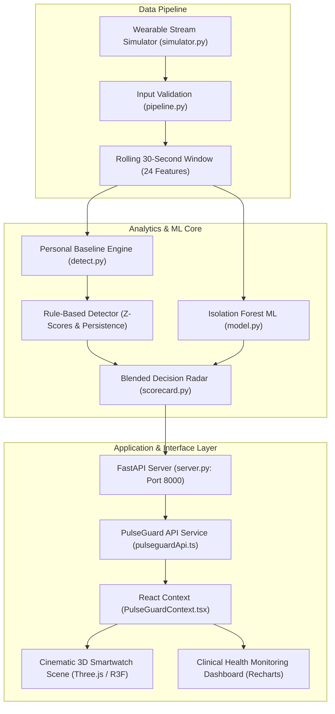

# PulseGuard — Real-Time Wearable Health Anomaly Radar

**Hackseries 2026 | Healthcare Track**

PulseGuard is an end-to-end wearable health-monitoring platform designed to detect unusual physiological patterns by learning an individual's personal baseline, analyzing multiple synchronized health signals, and generating explainable alerts.

Wearables collect health data continuously, but frequent or insignificant notifications cause severe **alert fatigue**. PulseGuard eliminates alert fatigue by learning each individual's baseline physiology, factoring in kinetic activity ($g$-force) and circadian time of day, and evaluating deviations across multiple signals rather than isolated reaadingjsjkfafufshjshjs.

> **Project Status:** Fully Integrated Production Prototype. Features the Python ML simulation and detection pipeline (Rules + Isolation Forest), high-performance FastAPI streaming layer, interactive 3D smartwatch in Three.js / React Three Fiber, and clinical triage dashboard.

---

## Table of Contents

- [Key Features](#key-features)
- [System Architecture](#system-architecture)
- [How It Works](#how-it-works)
- [Machine Learning: Isolation Forest & Blended Radar](#machine-learning-isolation-forest--blended-radar)
- [Project Structure](#project-structure)
- [Quick Start: Running Backend & Frontend](#quick-start-running-backend--frontend)
- [API Reference](#api-reference)
- [Testing and Evaluation](#testing-and-evaluation)
- [Presentation Dossier (PPT Deck)](#presentation-dossier-ppt-deck)
- [Disclaimer](#disclaimer)

---

## Key Features

| Feature | Description | Status |
|---|---|---|
| **Cinematic 3D Smartwatch** | Procedural 3D smartwatch with continuous rotation, floating physics, live ECG shader, and scroll-driven camera storytelling | **Live & Built** |
| **Wearable Data Simulator** | Continuous telemetry generator simulating circadian drift, exercise bursts, precursors, and decoys | **Live & Built** |
| **Input Validation** | Rejects invalid, missing, duplicate, and out-of-order readings; maintains rolling 30s window | **Live & Built** |
| **Personal Baseline Engine** | Activity-adjusted baselines ($y = a + b \cdot \text{accel}$) with separate day/night parameterizations | **Live & Built** |
| **Rule-Based Detector** | Composite Z-score metric with persistence filtering ($\ge 3$ s) to prevent false alerts | **Live & Built** |
| **Isolation Forest ML** | Unsupervised anomaly model trained on activity-adjusted residual feature vectors | **Live & Built** |
| **Blended Decision Radar** | Fuses rule tiers and ML flags to eliminate false alarms while capturing multi-signal outliers | **Live & Built** |
| **Clinical Monitoring Dashboard** | 5 diagnostic views: Live Monitor, Personal Baseline, Timeline, Response Center, Sandbox | **Live & Built** |
| **Scenario Injection Sandbox** | One-click triggers for Tachycardia, Hypoxia, Pyrexia/Fever, Fall, and Afib with real-time response | **Live & Built** |
| **FastAPI REST API** | Sub-10ms endpoints for real-time telemetry streaming, baseline retrieval, and stream control | **Live & Built** |

---

## System Architecture

PulseGuard processes wearable telemetry through a multi-tiered pipeline:



---

## How It Works

### 1. Multi-Signal Physiological Telemetry
Monitors 6 synchronized physiological streams:
- **Heart Rate (`hr`):** Beats per minute (BPM)
- **Blood Oxygen Saturation (`spo2`):** Percentage (%)
- **Skin Temperature (`temp`):** Degrees Celsius (°C)
- **Respiratory Rate (`rr`):** Breaths per minute
- **Heart Rate Variability (`hrv`):** Beat-to-beat RMSSD (ms)
- **Perfusion Index (`pi`):** Peripheral pulse strength (%)
- **Kinetic Acceleration (`accel`):** Motion magnitude ($g$-force)

### 2. Activity-Adjusted Personal Baseline
Instead of static population cutoffs, PulseGuard fits an online linear model:
$$y = a + b \cdot \text{accel}$$
When a user exercises, the expected heart rate scales upward smoothly. An elevated heart rate of 120 BPM during exertion is recognized as nominal, while 120 BPM during stationary sleep triggers an immediate alert.

### 3. Machine Learning: Isolation Forest & Blended Radar
- **Residual Feature Space:** Model subtracts expected activity values to prevent standard motion from diluting detection.
- **Dense 5-Feature Vector:**
  1. `last.max`: Peak instantaneous vital deviation.
  2. `mean.max`: Peak 30-second rolling deviation.
  3. `outlier_count`: Number of vitals showing $z > 2.0$.
  4. `accel_max`: Peak acceleration in the window (preserves fall impacts).
  5. `irr_frac`: Fraction of window flagging irregular pulse rhythm.
- **Blended Radar:** Alerts when rules fire directly or when the Isolation Forest flags an outlier with elevated rule corroboration ($\ge 4.5$).

---

## Project Structure

```text
Hackseries-3.O/
├── backend/
│   ├── simulator.py        # Patient stream generator & scenarios
│   ├── pipeline.py         # Input validation & rolling window
│   ├── detect.py           # Personal baseline & rule detector
│   ├── model.py            # Isolation Forest ML model
│   ├── scorecard.py        # Blended Decision Radar
│   ├── forecast.py         # Precursor early-warning classifier
│   ├── forecast_model.joblib # Trained precursor model
│   ├── server.py           # FastAPI REST API implementation
│   ├── main.py             # Server entry point
│   ├── test_integration.py # Automated integration test suite
│   ├── check_all.py        # Algorithmic regression suite
│   ├── export_data.py      # Dataset export pipeline
│   └── requirements.txt    # Python dependencies
├── data/
│   ├── train.csv           # Training dataset
│   ├── val.csv             # Validation dataset
│   └── test.csv            # Test evaluation dataset
├── src/
│   ├── components/
│   │   ├── 3d/             # Three.js / R3F smartwatch & procedural canvas dial
│   │   ├── dashboard/      # Live Monitor, Baseline, Timeline, Response Center, Settings
│   │   ├── sections/       # Hero narrative, navigation & layout
│   │   └── ui/             # Footer & reusable UI atoms
│   ├── context/            # PulseGuard React Context state engine
│   ├── services/           # Typed API service layer (pulseguardApi.ts)
│   ├── types/              # TypeScript schemas (pulseguard.ts)
│   ├── App.tsx             # Root application component
│   ├── main.tsx            # React entry point
│   └── index.css           # Styling & design system tokens
├── PRESENTATION_DOSSIER.md # Complete slide-by-slide PPT pitch deck
├── index.html              # HTML entry point
├── package.json            # Frontend dependencies
├── vite.config.ts          # Vite configuration
└── README.md               # Project documentation
```

---

## Quick Start: Running Backend & Frontend

### Prerequisites
- Python 3.10+ (tested with Python 3.14)
- Node.js 18+ and `npm`

### 1. Launch Python ML Backend
```bash
cd backend
python -m pip install -r requirements.txt
python -m uvicorn server:app --host 127.0.0.1 --port 8000 --reload
```
The API is available at `http://127.0.0.1:8000` (docs at `http://127.0.0.1:8000/docs`).

### 2. Launch React 3D Frontend
In a separate terminal:
```bash
npm install
npm run dev
```
Open [http://127.0.0.1:5173/](http://127.0.0.1:5173/) in your browser.

---

## API Reference

| Method | Endpoint | Description |
|---|---|---|
| `GET` | `/api/health` | Service status, patient profile, model loaded state, threshold |
| `GET` | `/api/readings/current` | Real-time telemetry tick, rule status, and Isolation Forest score |
| `GET` | `/api/readings/history` | Chronological buffer of the latest 60 readings |
| `GET` | `/api/baseline` | Patient-specific empirical resting/active envelopes |
| `GET` | `/api/events` | Historical anomaly events with duration counters |
| `POST` | `/api/events/{id}/acknowledge`| Marks an alert event as reviewed |
| `POST` | `/api/stream/control` | Control streaming state (`{"action": "pause" \| "resume"}`) |
| `POST` | `/api/scenario/inject` | Trigger test scenario (`cardiac_spike`, `hypoxia`, `fever`, `fall`, `afib`, `normal`) |

---

## Testing and Evaluation

Run the automated integration and regression suites:

```bash
# Run API Integration Tests
python backend/test_integration.py

# Run Core Algorithmic Regression Suite
python backend/check_all.py
```

### Measured Performance
- **Idle-Stream False Alarms:** **0 false alert ticks** across 18 independent runs.
- **Event Detection Recall:** **100%** (zero missed events across 24 runs).
- **Cardiac Spike Latency:** **2.0 seconds**.
- **Fall Detection:** **Immediate (0 seconds)**.
- **Hypoxia Latency:** **9.0 seconds**.
- **Fever Latency:** **23.0 seconds**.
- **Multi-Patient Isolation:** Spike on Patient P2 triggers alerts exclusively on P2; P1 and P3 remain nominal.

---

## Presentation Dossier (PPT Deck)

A complete 12-slide presentation deck with slide layouts, talking points, visual diagrams, and speaker notes is included in:
👉 [`PRESENTATION_DOSSIER.md`](./PRESENTATION_DOSSIER.md)

---

## Disclaimer

PulseGuard is a technological prototype developed for interactive demonstration, algorithmic exploration, and UI design verification. It is not an FDA-cleared diagnostic medical device. It does not replace professional clinical evaluation, electrocardiography, or acute emergency medical intervention.
