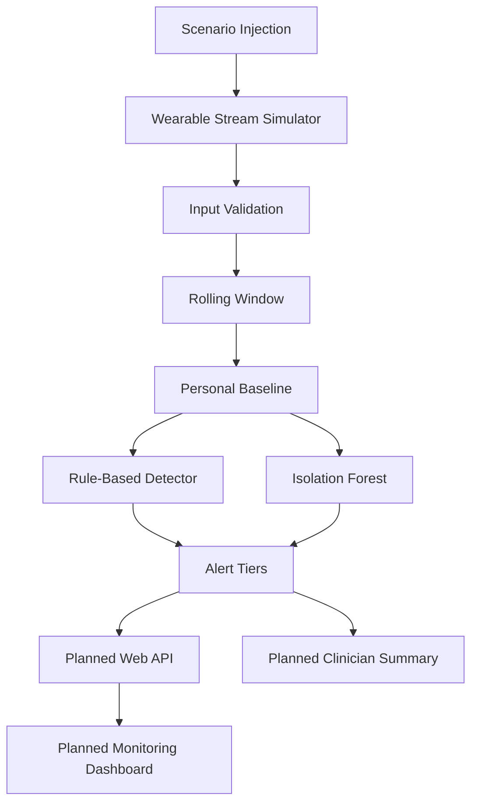

# PulseGuard — Real-Time Wearable Health Anomaly Radar

**Hackseries 2026 | Healthcare Track**

PulseGuard is a wearable health-monitoring prototype designed to detect unusual physiological patterns by learning an individual's personal baseline, analyzing multiple health signals, and generating explainable alerts.

Wearables collect health data continuously, but frequent or insignificant notifications can lead to **alert fatigue**. PulseGuard aims to address this problem by considering a person's usual physiology, activity level, time of day, and changes across multiple signals rather than relying on isolated readings.

Our goal is simple: **turn raw wearable readings into meaningful, understandable health alerts.**

> **Project status:** Hackathon prototype under development. The core Python simulation and detection pipeline are implemented, while the web dashboard, API integration, and clinician-summary workflow remain under development.

---

## Table of Contents

- [The Problem](#the-problem)
- [Our Solution](#our-solution)
- [Key Features](#key-features)
- [System Architecture](#system-architecture)
- [How It Works](#how-it-works)
- [Technology Stack](#technology-stack)
- [Project Structure](#project-structure)
- [Getting Started](#getting-started)
- [Testing and Evaluation](#testing-and-evaluation)
- [Implementation Status](#implementation-status)
- [Roadmap](#roadmap)
- [Limitations](#limitations)
- [Disclaimer](#disclaimer)

---

## The Problem

Wearable devices continuously collect information such as heart rate, blood oxygen saturation, skin temperature, and activity.

However, a reading that is unusual for one person may be normal for another. Physical activity can increase heart rate, while a combination of unusual readings may be more meaningful than any single measurement.

Traditional threshold-based monitoring can therefore produce unnecessary alerts or miss patterns that require attention.

PulseGuard explores a more personalized approach that considers:

- Individual physiological baselines.
- Activity-adjusted readings.
- Daytime and nighttime patterns.
- Multiple physiological signals.
- Persistent changes instead of isolated fluctuations.
- Clear explanations for detected anomalies.

## Our Solution

PulseGuard combines a simulated wearable data stream, personalized baseline estimation, rule-based anomaly detection, and machine learning to identify unusual physiological patterns.

The prototype is designed around four principles:

1. **Personalized monitoring:** Learn normal patterns separately for each simulated patient, accounting for activity and time of day.
2. **Multisignal awareness:** Evaluate heart rate, SpO₂, skin temperature, respiratory rate, and acceleration together.
3. **Explainable alerts:** Provide alert tiers and reasons describing which signals deviate from the expected baseline.
4. **Reliable demonstration:** Use repeatable simulated scenarios to evaluate detection behavior without requiring a physical wearable.

The planned frontend will present this information through a cinematic, scroll-driven 3D smartwatch experience and a functional monitoring dashboard.

---

## Key Features

| Feature                        | Description                                                                                   | Status                                     |
| ------------------------------ | --------------------------------------------------------------------------------------------- | ------------------------------------------ |
| Wearable data simulator        | Generates readings for three simulated patients at one-second intervals                       | Built                                      |
| Input validation               | Rejects invalid, missing, duplicate, out-of-order, and out-of-range readings                  | Built                                      |
| Rolling data window            | Maintains the latest 30 readings per patient                                                  | Built                                      |
| Personal baseline              | Activity-adjusted baselines with separate day/night behavior                                  | Built                                      |
| Rule-based detection           | Uses deviation scores, alert thresholds, and persistence filtering                            | Built                                      |
| Fall detection                 | Detects simulated acceleration impacts of 2.5 g or more                                       | Built                                      |
| Isolation Forest               | Per-person anomaly model using activity-adjusted features                                     | Built; evaluation needs improvement        |
| Alert tiers                    | Learning, normal, watch, and alert states                                                     | Built                                      |
| Multi-patient monitoring logic | Tracks patients independently so one patient's spike does not trigger another patient's alert | Logic tested; interface pending            |
| Scenario injection             | Simulated cardiac spike, hypoxia, fever, and fall scenarios                                   | Simulator implemented; UI controls pending |
| Visual explanations            | Per-signal explanations and detailed alert presentation                                       | Partially implemented                      |
| Interactive dashboard          | Live readings, graphs, patient monitoring, and alerts                                         | Planned                                    |
| Backend API                    | Streaming and scenario-injection endpoints                                                    | Planned                                    |
| Clinician summary              | Ready-to-review summary with an offline template fallback                                     | Planned                                    |
| Live performance scorecard     | Precision, recall, and detection latency                                                      | Planned                                    |

*Status reflects the implementation documented in the project report dated 11 October 2026.*

---

## System Architecture

The current core pipeline processes simulated wearable readings, validates the data, updates rolling windows, and evaluates physiological deviations.



### Architecture components

- **Simulator:** Produces timestamped physiological readings and controlled test scenarios.
- **Validation pipeline:** Checks data quality and maintains a rolling window for each patient.
- **Personal baseline:** Estimates expected readings using activity and time-of-day context.
- **Rule-based detector:** Scores deviations and applies persistence logic to reduce noise.
- **Isolation Forest:** Learns patterns from normal-looking, activity-adjusted readings.
- **Alert engine:** Converts detector scores into monitoring states and explainable alerts.
- **Dashboard and API:** Planned integration for live visualization, scenario injection, and alert delivery.

The simulator currently stands in for a physical wearable. Direct hardware integration is not yet implemented.

---

## How It Works

### 1. Simulated data ingestion

The simulator produces readings for multiple patients, including:

- Heart rate (`hr`) — beats per minute.
- Blood oxygen saturation (`spo2`) — percentage.
- Skin temperature (`temp`) — degrees Celsius.
- Respiratory rate (`rr`) — breaths per minute.
- Acceleration magnitude (`accel`) — g.
- Activity level (`activity`) — simulated activity context.

Each reading includes patient identification and a monotonically increasing simulation tick.

### 2. Input validation

Before processing, readings are checked for missing or invalid fields, unsupported ranges, duplicate timestamps, and out-of-order data.

Invalid readings are rejected and counted instead of being allowed to trigger alerts.

### 3. Personal baseline estimation

PulseGuard estimates expected readings for each patient using their historical data, activity level, and day/night context.

The baseline is updated only when readings appear normal, reducing the risk of learning an ongoing anomaly as a person's normal state.

### 4. Rule-based anomaly detection

The rule detector calculates deviations between observed readings and their expected values.

The system applies smoothing, scoring, and persistence rules to distinguish isolated fluctuations from sustained changes. Low oxygen saturation and elevated temperature are treated as relevant danger signals in the documented scoring logic.

### 5. Machine learning detection

An Isolation Forest model is trained separately for each simulated patient using activity-adjusted residual features.

The model provides a second approach to identifying unusual patterns. Its current performance is still being evaluated, and it is not yet reliably calibrated for every simulated scenario.

### 6. Alert generation

The alert engine classifies readings into learning, normal, watch, and alert states.

Alerts include a reason string, and the planned interface will display contributing signals, event history, and a clinician-summary preview.

---

## Technology Stack

| Layer                | Technology                                        | Purpose                                                 |
| -------------------- | ------------------------------------------------- | ------------------------------------------------------- |
| Programming language | Python 3.14                                       | Simulation, validation, and detection                   |
| Numerical computing  | NumPy 2.4.2                                       | Numerical calculations and baseline fitting             |
| Machine learning     | scikit-learn 1.8.0                                | Isolation Forest anomaly detection                      |
| Core pipeline        | Python standard library                           | Data processing and state management                    |
| Backend API          | FastAPI (proposed)                                | Streaming and scenario-injection endpoints              |
| Frontend             | Web application (planned)                         | Monitoring dashboard and visual alerts                  |
| 3D experience        | Three.js / React Three Fiber with GSAP (proposed) | Cinematic 3D smartwatch and scroll-driven animation     |
| Clinician summary    | Claude API (planned)                              | Drafting a structured summary, with a template fallback |

The backend and frontend choices may change as implementation progresses. The 3D stack describes the intended interface direction, not a completed integration.

---

## Project Structure

The current core Python files documented in the project report are:

```text
PulseGuard/
├── src/
│   ├── simulator.py    # Simulated patients, readings and scenarios
│   ├── pipeline.py     # Input validation and rolling windows
│   ├── detect.py       # Personal baseline and rule-based detection
│   ├── model.py        # Isolation Forest model
│   └── check_all.py    # Regression checks
├── START_HERE.md       # Project handoff notes
├── CONTEXT.md          # Context and design decisions
└── PROGRESS.md         # Implementation progress
```

The planned web application, API, and dashboard files should be added as those components are implemented.

---

## Getting Started

### Prerequisites

- Python 3.14, as used in the documented implementation.
- `pip`
- Git

### 1. Clone the repository

```bash
git clone <YOUR_GITHUB_REPOSITORY_URL>
cd <YOUR_PROJECT_DIRECTORY>
```

Replace the placeholders with your actual repository URL and directory name.

### 2. Create a virtual environment

**Windows — PowerShell**

```powershell
python -m venv .venv
.\.venv\Scripts\Activate.ps1
```

**macOS / Linux**

```bash
python3 -m venv .venv
source .venv/bin/activate
```

### 3. Install dependencies

Install the numerical computing and machine learning dependencies used by the documented implementation:

```bash
python -m pip install numpy==2.4.2 scikit-learn==1.8.0
```

### 4. Run the simulator

From the project root:

```bash
python src/simulator.py
```

### 5. Run the rule-based detector

```bash
python src/detect.py
```

### 6. Run the regression suite

```bash
python src/check_all.py
```

**Current testing note:** The documented regression suite passes 3 of 4 checks. The remaining failure concerns Isolation Forest performance on a cardiac-spike scenario. See [Testing and Evaluation](#testing-and-evaluation).

---

## Testing and Evaluation

The core pipeline has been tested using simulated readings and repeatable anomaly scenarios.

| Evaluation                                | Reported result                                 |
| ----------------------------------------- | ----------------------------------------------- |
| Rule detector, idle-stream stress test    | Zero false alert readings across 18 idle runs   |
| Rule detector, injected-event stress test | Zero missed events across 24 event runs         |
| Cardiac-spike detection latency           | Approximately 2 seconds                         |
| Hypoxia detection latency                 | Approximately 9 seconds                         |
| Fever detection latency                   | Approximately 23 seconds                        |
| Fall detection latency                    | Immediate in the simulated scenario             |
| Multi-patient isolation                   | A spike on one patient alerts only that patient |
| Regression suite                          | 3 of 4 checks pass                              |

### Machine learning evaluation

The Isolation Forest results vary across random seeds:

- With seed 10, the report records event-window detection rates of 100% for cardiac spikes, 96% for hypoxia, 87% for fever, and 100% for falls.
- With seed 11, the corresponding rates are 37%, 90%, 86%, and 75%.
- The regression suite currently fails the ML check because cardiac-spike detection falls below the required test threshold.

These results demonstrate why the machine learning component requires further calibration and testing.

**Important:** All results above are measured on synthetic data. They do not demonstrate clinical accuracy or real-world medical performance.

---

## Implementation Status

### Built

- Multi-patient synthetic wearable stream.
- Data validation and rolling windows.
- Activity-adjusted personal baselines.
- Rule-based anomaly scoring and alert tiers.
- Simulated fall detection.
- Per-person Isolation Forest model.
- Core self-check and regression scripts.

### In progress

- Scenario controls and multi-patient visualization.
- More detailed alert explanations.
- Machine learning evaluation and calibration.
- Integration of detection results into a unified user experience.

### Planned

- Live web API and monitoring dashboard.
- Cinematic 3D smartwatch interface with scroll-driven animation.
- Live scorecard for detection performance.
- Clinician-summary generation with an offline template fallback.
- Integrated alert handling and scenario controls.

---

## Roadmap

- [x] Implement the simulated wearable data stream.
- [x] Validate incoming readings and maintain rolling windows.
- [x] Develop activity-adjusted personal baselines.
- [x] Implement explainable rule-based anomaly detection.
- [x] Develop the Isolation Forest model.
- [x] Improve and validate machine learning performance.
- [x] Build the backend streaming and injection API.
- [x] Develop the cinematic 3D frontend and live monitoring dashboard.
- [x] Integrate patient views, anomaly timelines, and alert explanations.
- [x] Implement the clinician-summary workflow with a fallback template.
- [x] Add a live performance scorecard and complete end-to-end regression testing.

---

## Limitations

- **Synthetic data:** The current prototype uses simulated readings and is not clinically validated.
- **Machine learning reliability:** Isolation Forest performance varies across test seeds and requires further improvement.
- **Learning period:** Alerts are suppressed until sufficient baseline data is collected. The documented setup requires pre-calibration for the hackathon demonstration.
- **No direct wearable integration:** Real-device ingestion has not been implemented.
- **Frontend and API:** The dashboard, web API, and complete end-to-end alert workflow remain planned components.
- **Clinician summary:** External API integration is not yet connected; a template fallback is planned.
- **Simulation time:** Each simulator tick represents one second, so day/night changes are accelerated only if explicitly configured.

---

## Disclaimer

PulseGuard is an experimental hackathon prototype intended to demonstrate personalized physiological anomaly monitoring.

It is **not a medical device, diagnostic system, or substitute for professional medical advice**. Simulated alerts and test results must not be interpreted as proof of clinical accuracy, emergency prediction, or prevention of medical events.

No real patient data or physical wearable connection is required for the current demonstration.

---

## Contributing

Contributions, feedback, and ideas for improving the simulation, anomaly detection, visualization, and testing are welcome.

1. Fork the repository.
2. Create a feature branch.
3. Implement and test your changes.
4. Submit a pull request describing the changes.

Please preserve the distinction between simulated and real readings, document new detection rules, and add repeatable tests for changes to the anomaly pipeline.

---

**PulseGuard — Because understanding a change matters more than simply collecting a reading.**
